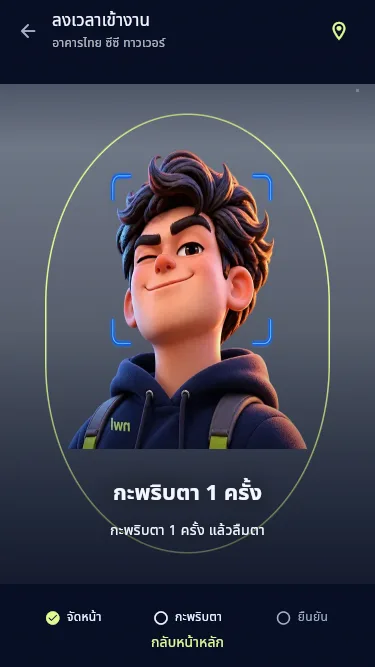
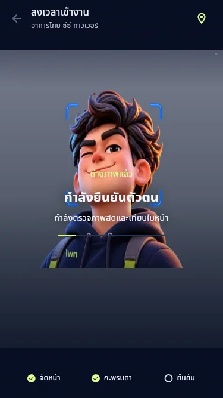

# Fullscreen camera guidance — 18 November 2026

The camera now uses the whole scan page. A compact header names the selected attendance location; its pin opens the full address and coordinates. Guidance and countdown text appear over the lower preview, with three small progress indicators. Safe areas protect controls from device cutouts and home indicators. Error guidance can scroll at larger accessibility text sizes.

Mobile portrait sessions request 960 × 1280, while landscape/desktop request 1280 × 960. These are optional browser preferences: actual camera capabilities determine delivered dimensions. The preview contains the entire source frame, mirrors it for positioning, and fits its guide to the actual video aspect ratio. Existing quality selection and bounded JPEG encoding remain in place. Overlay text is a separate display layer and is never burned into the submitted photo.

The exact JPEG selected for verification becomes the video's poster before camera tracks stop. It stays visible while waiting for the API, and is cleared on a new camera start. It is not written to local storage. Authentication, provider verification, attendance payloads and duplicate-submission protections retain their existing behavior.

## Validation

- Flutter analyzer: no issues.
- Existing Flutter suite: 100 passed. Additional device-inset cases cover 320 × 568, 375 × 553, 390 × 844, 430 × 932 and 667 × 375, including retry and return controls above a simulated home indicator.
- Node server suite: 38 passed.
- Release web build succeeded with Flutter 3.35.7.
- Updated visual baselines: `test/captures/iphone8-scan.png`, `clock-in.png`, `clock-out.png`.

| Chromium viewport | Camera source in fixture | Result |
| --- | --- | --- |
| 375 × 667 — iPhone 8 CSS size | 960 × 1280 | Passed |
| 375 × 553 — compact browser content area | 960 × 1280 | Passed |
| 390 × 844 | 960 × 1280 | Passed |
| 844 × 390 — landscape | 1280 × 960 | Passed |
| 1366 × 768 | 1280 × 960 | Passed |
| 1440 × 900 | 1280 × 960 | Passed |

Each browser run used a canvas camera and synthetic landmark/API responses. Assertions checked full-viewport video bounds, a single blink cycle, retained poster after stopping tracks, exact JPEG equality across poster/verify/submit, delivered aspect ratio, and exactly one verify and one submit request. These tests do not measure HONO's real facial matching accuracy. No real attendance was submitted.

Actual iPhone 8 Safari, Android camera hardware, exposure/autofocus and real employee verification still require device testing. Larger preview area supports positioning; it does not itself guarantee a higher verification success rate or additional sensor resolution. No claim is made that all devices were physically tested.

## Browser captures

These contain a character image from the asset pack as a clearly synthetic camera fixture, not a real employee's face.

